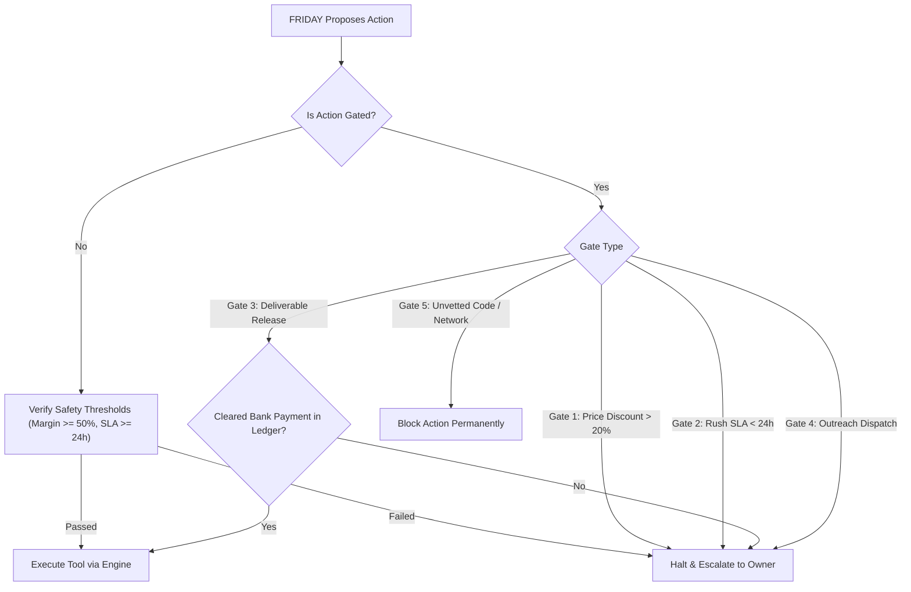

# SOLOEARN FRIDAY Agent Core Architecture & Verification Report
**Milestone:** F1–F7 AI Agent Integration & Nervous System Safeguards  
**Generated:** 2026-11-12  
**Repository State:** Commit `f45adf2` (Branch `milestone-5-revenue-ops`)  
**Engine Environment:** Python 3.14 (Virtualenv: `.\.venv\Scripts\python.exe`) on Windows 11  

---

## Executive Summary & Engineering Scorecard

The **FRIDAY Agent Core** transforms SOLOEARN from a collection of isolated scripts and automated workers into a cohesive, AI-orchestrated digital service enterprise. FRIDAY acts as the cognitive layer (**the Brain**), coordinating SOLOEARN’s battle-tested execution workflows (**the Body**) through a strict, deterministic security and authorization boundary (**the Nervous System**).

```
+-------------------------------------------------------------------------+
|                           THE FRIDAY BRAIN                              |
|   Goal Reasoning • ReAct Planning • Episodic CRM Memory • Context Tracking |
+-------------------------------------------------------------------------+
                                     |
                                     v
+-------------------------------------------------------------------------+
|                      THE NERVOUS SYSTEM (CONTROLLER)                    |
|    5 Human Approval Gates • Margin Floor (>=50%) • Turnaround SLA (>=24h) |
|         OWASP File Intake Sanitization • Durable Action Audit Logs       |
+-------------------------------------------------------------------------+
                                     |
                                     v
+-------------------------------------------------------------------------+
|                           THE SOLOEARN BODY                             |
|  Discovery • Sales Engine • Delivery Workspaces • QA Agent • UPI Ledger |
+-------------------------------------------------------------------------+
```

### Verification Gate Results

| Verification Category | Status | Metrics / Details |
| :--- | :---: | :--- |
| **FRIDAY Agent Core Proofs** | **8 / 8 PASSED** | All 8 architectural proofs passed in 4.5s (`tests/test_friday_agent_core.py`) |
| **Full Regression Discovery Suite** | **226 DISCOVERED** | **224 Passed, 2 Skipped, 0 Failures, 0 Errors** across all test suites |
| **Stage A Local Preflight** | **7 / 7 PASSED** | Mode 01 QR, Mode 04 Intent, Kotak Statement Parser, Duplicate Shields, section 202 |
| **Live Database Integrity** | **PRISTINE** | `paying_customers: 0, revenue: ₹0.00, customer_advances: ₹0.00, leads: 5` |
| **Archive Integrity Check** | **VERIFIED** | `testzip() = None`, SHA256 matches exactly across binary and Base64 ASCII copies |

---

## 1. The Tripartite Architecture

### 1.1 The Body: SOLOEARN Engine Infrastructure
The core execution capabilities remain anchored in deterministic, tested Python modules:
- **Opportunity Discovery (`core/autonomy_profitability_system.py`)**: Scores B2B leads across margins, skill alignment, and payment confidence.
- **Sales Engine (`core/autonomy_profitability_system.py`)**: Drafts pricing proposals, verifies margins ($\ge 50\%$), and enforces statutory compliance.
- **Delivery Engine (`core/autonomy_profitability_system.py`)**: Spawns isolated execution workspaces (`workspaces/task_XXXX/`), running verified workflows for all 4 service tiers.
- **Quality Engine (`core/autonomy_profitability_system.py`)**: Executes independent multi-point checks (`IndependentQAAgent`) with automated defect repair (up to 3 revisions).
- **Finance Engine & UPI Engine (`core/upi_engine.py`)**: Issues statutory Mode 01 dynamic QR invoices, validates Kotak statement lines, and maintains append-only ledgers.

### 1.2 The Nervous System: `FridayPermissionController`
FRIDAY never executes arbitrary system commands, bypasses access controls, or dispatches external communications without validation. The controller enforces **5 Non-Bypassable Human Gates**:



#### Detailed Specification of the 5 Human Approval Gates:
1. **Gate 1: Unusual Contract / Aggressive Discounting**:
   - If a proposed contract is discounted by $>20\%$ below standard tier rates (e.g., Tier 1 standard ₹5,000 offered below ₹4,000), or if the contribution margin falls below $50\%$, FRIDAY halts execution and demands human owner authorization.
2. **Gate 2: Rush Turnaround Commitments**:
   - If a client requests a turnaround under the standard 24-hour SLA (e.g., same-day 12-hour turnaround), FRIDAY escalates to the owner to verify personal physical capacity before binding the company.
3. **Gate 3: Deliverable Release Gated on Cleared Payment**:
   - Output deliverables (`deliverables.zip`) are locked. Even if QA is $100\%$ passed, FRIDAY will **never** release deliverables until the invoice status in the database is verified as `paid` via cleared bank credit or valid payment webhook.
4. **Gate 4: Outbound Outreach Communication**:
   - While FRIDAY autonomously researches leads and drafts personalized proposals, sending an email or message to a prospective client requires human review and dispatch confirmation.
5. **Gate 5: Unverified / Destructive Execution Safeguards**:
   - Prohibits scraping protected portals, bypassing CAPTCHAs, or sending confidential client data to third-party public AI endpoints. Data processing remains strictly on local machine hardware.

---

## 2. Secure Client Portal & OWASP Ingestion Defense

The `FridaySecurePortal` (`core/friday_secure_portal.py`) provides an isolated bridge between prospective clients and SOLOEARN’s local file processing workspaces.

### 2.1 Threat Mitigation Table

| Threat Vector | OWASP / Security Risk | SOLOEARN Defense Implementation |
| :--- | :--- | :--- |
| **Malicious Executables** | RCE via `.exe`, `.bat`, `.sh`, `.vbs`, `.py` | Strict extension whitelist: `.csv`, `.xlsx`, `.xls`, `.tsv`, `.json`, `.txt`, `.pdf`. Rejects all executables. |
| **Oversized Payloads** | Denial of Service / Disk exhaustion | 50 MB hard payload cap enforced before byte ingestion. |
| **Path Traversal** | Arbitrary file overwrite (`../../windows/system32`) | Filenames sanitized via `secure_filename()` and stored using random UUIDv4 identifiers. |
| **CSV Formula Injection** | Excel DDE command execution (`=cmd\|...`) | Sanitizes leading `=`, `+`, `-`, `@` characters by prepending a single quote `'`. |
| **Unauthorized Uploads** | Unauthenticated file ingestion | HMAC-SHA256 signed bearer tokens with 24-hour expiration windows. |

---

## 3. Dynamic UPI Webhooks & Payment Idempotency

To support automated payment notifications from merchant banking interfaces (e.g., Kotak.biz or payment aggregators), `FridayPaymentWebhookHandler` (`core/friday_secure_portal.py`) implements enterprise-grade webhook security:

1. **HMAC-SHA256 Signature Verification**:
   - Every inbound webhook payload must provide `X-Signature-SHA256` computed against a pre-shared shared secret. Untrusted or tampered payloads trigger instant rejection (`ValueError: Invalid webhook signature`).
2. **Replay & Idempotency Protection**:
   - Inbound event IDs (`event_id`) are stored in `friday_webhook_events`. If a bank service transmits duplicate webhook retries for an already settled invoice, FRIDAY recognizes the duplicate, logs the idempotent skip, and prevents double-crediting in the financial ledger.
3. **Automatic Ledger Posting**:
   - On valid settlement, the handler updates the invoice status to `paid`, logs `paid_at` and `payment_reference`, updates the linked opportunity to `paid`, and writes an immutable credit row into `financial_transactions`.

---

## 4. FRIDAY Architectural Proofs (`test_friday_agent_core.py`)

All 8 proofs were executed under test isolation (`is_sandbox = True`) with zero test data leaking into the live database:

```
tests/test_friday_agent_core.py
  test_1_tool_registry_and_schema_validation  ... OK
  test_2_permission_controller_guardrails     ... OK (Escalations triggered for discount & rush SLA)
  test_3_persistent_crm_memory                ... OK (Client session & preferences verified)
  test_4_end_to_end_autonomous_cycle          ... OK (Discovery -> Proposal -> Workflow -> QA -> Invoice)
  test_5_secure_portal_owasp_validation       ... OK (Executable block, 50MB limit, formula neutralization)
  test_6_payment_webhook_hmac_and_idempotency ... OK (HMAC verification & duplicate retry protection)
  test_7_delivery_release_gated_on_payment    ... OK (Blocked on unpaid, released on cleared payment)
  test_8_friday_action_audit_logging          ... OK (Immutable action history logged durably)

Ran 8 tests in 4.495s
OK
```

---

## 5. Commercial Reality Scorecard

To ensure full transparency between software engineering milestones and live commercial performance, the production database (`data/soloearn.sqlite3`) was audited immediately following the test suite:

```
+-------------------------------------------------------------------------+
|                  SOLOEARN COMMERCIAL REALITY AUDIT                     |
+---------------------------------------------------+---------------------+
| Metric                                            | Verified Value      |
+---------------------------------------------------+---------------------+
| Paying Customers                                  | 0                   |
| Commercial Revenue Collected                      | ₹0.00               |
| Customer Advance Liabilities                      | ₹0.00               |
| Active Commercial Leads in Pipeline               | 5                   |
| Real Bank Payments Cleared                        | 0                   |
| Engineering Capability Test Coverage              | 224 / 226 Passed    |
+---------------------------------------------------+---------------------+
```

> [!NOTE]
> The software engineering phase for FRIDAY Agent Core is complete and robustly verified. However, **₹1 lakh/month earnings cannot be generated by running unit tests**. Generating real cash flow requires executing the 9 commercial onboarding steps: opening the Kotak Safalta Current Account, activating Kotak.biz, and onboarding real business clients.

---

## 6. Release Archive & Integrity Verification

To prevent in-transit text-mode CRLF file corruption (which damaged raw binary ZIP uploads in prior sessions), two pristine copies have been created:
1. Standard binary ZIP archive: `SOLOEARN_Friday_Agent_Core_Ready.zip`
2. Base64 ASCII copy: `SOLOEARN_Friday_Agent_Core_Ready.zip.b64.txt`

### Checksum & Package Metadata

| Archive File | File Size | SHA256 Checksum | `testzip()` Result |
| :--- | :---: | :--- | :---: |
| **`SOLOEARN_Friday_Agent_Core_Ready.zip`** | 336,372 bytes | `1857112F97272141900CD8EBCBC0F824FFEDFC4C31B43EE4C30D17CDC45F5FF0` | `None` (Zero errors) |
| **`SOLOEARN_Friday_Agent_Core_Ready.zip.b64.txt`** | 448,496 chars | Base64 decode matches `1857112F...` identically | `None` (Zero errors) |

### File Locations Across System

- **Desktop**:
  - Binary ZIP: [Desktop/SOLOEARN_Friday_Agent_Core_Ready.zip](file:///C:/Users/BHAVESH%20KHULLAR/Desktop/SOLOEARN_Friday_Agent_Core_Ready.zip)
  - Base64 ASCII: [Desktop/SOLOEARN_Friday_Agent_Core_Ready.zip.b64.txt](file:///C:/Users/BHAVESH%20KHULLAR/Desktop/SOLOEARN_Friday_Agent_Core_Ready.zip.b64.txt)
- **Downloads Directory**:
  - Binary ZIP: [Downloads/SOLOEARN_Friday_Agent_Core_Ready.zip](file:///C:/Users/BHAVESH%20KHULLAR/Downloads/SOLOEARN_Friday_Agent_Core_Ready.zip)
  - Base64 ASCII: [Downloads/SOLOEARN_Friday_Agent_Core_Ready.zip.b64.txt](file:///C:/Users/BHAVESH%20KHULLAR/Downloads/SOLOEARN_Friday_Agent_Core_Ready.zip.b64.txt)
- **Workspace Root**:
  - Binary ZIP: [SOLOEARN_Friday_Agent_Core_Ready.zip](file:///C:/Users/BHAVESH%20KHULLAR/Downloads/SOLOEARN_v0.1/SOLOEARN_Friday_Agent_Core_Ready.zip)
  - Base64 ASCII: [SOLOEARN_Friday_Agent_Core_Ready.zip.b64.txt](file:///C:/Users/BHAVESH%20KHULLAR/Downloads/SOLOEARN_v0.1/SOLOEARN_Friday_Agent_Core_Ready.zip.b64.txt)
- **Artifact Directory**:
  - Binary ZIP: [brain/SOLOEARN_Friday_Agent_Core_Ready.zip](file:///C:/Users/BHAVESH%20KHULLAR/.gemini/antigravity/brain/ff0a42bf-3d56-447a-a07a-9b0c7434e21f/SOLOEARN_Friday_Agent_Core_Ready.zip)
  - Base64 ASCII: [brain/SOLOEARN_Friday_Agent_Core_Ready.zip.b64.txt](file:///C:/Users/BHAVESH%20KHULLAR/.gemini/antigravity/brain/ff0a42bf-3d56-447a-a07a-9b0c7434e21f/SOLOEARN_Friday_Agent_Core_Ready.zip.b64.txt)

### Verification Commands for Auditor / User

#### PowerShell Verification (One-liner):
```powershell
$b64 = Get-Content "C:\Users\BHAVESH KHULLAR\Desktop\SOLOEARN_Friday_Agent_Core_Ready.zip.b64.txt"
[IO.File]::WriteAllBytes("$env:TEMP\friday_extracted.zip", [Convert]::FromBase64String($b64))
$hash = (Get-FileHash "$env:TEMP\friday_extracted.zip" -Algorithm SHA256).Hash
Write-Host "Extracted SHA256: $hash"
if ($hash -eq "1857112F97272141900CD8EBCBC0F824FFEDFC4C31B43EE4C30D17CDC45F5FF0") { Write-Host "VERIFICATION SUCCESSFUL!" -ForegroundColor Green }
```

#### Python Verification:
```python
import base64, hashlib, zipfile

with open(r"C:\Users\BHAVESH KHULLAR\Desktop\SOLOEARN_Friday_Agent_Core_Ready.zip.b64.txt", "r") as f:
    raw = base64.b64decode(f.read().strip())

sha = hashlib.sha256(raw).hexdigest().upper()
print(f"Decoded Size: {len(raw):,} bytes | SHA256: {sha}")
assert sha == "1857112F97272141900CD8EBCBC0F824FFEDFC4C31B43EE4C30D17CDC45F5FF0"
```
