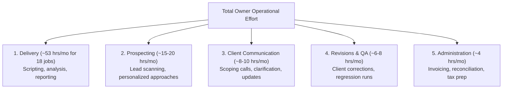
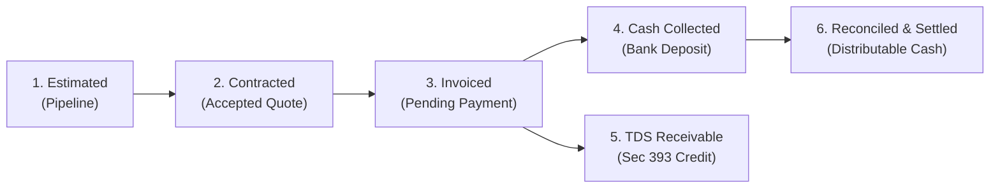

# SOLOEARN Unit Economics & Net Profit Progression Model (M6.3)

To achieve the North Star objective of **₹1,00,000 per month in net owner profit** with an internal **₹1,25,000 / month operating safety buffer**, every customer engagement must be evaluated using post-tax unit economics, ex-GST base pricing, and aggregate annual tax modeling under the **Income-tax Act, 2025**.

---

## 1. Unit Economics by Service Package (Strictly Ex-GST)

All package prices are **quoted excluding GST**. If the business is registered under GST, statutory tax (18%) is charged on top of these base quotes and held in the statutory GST liability reserve. **GST is never counted as business revenue.**

Under the Income-tax Act, 2025 (Section 202 slabs and Section 156 rebate for resident sole proprietors), income tax is **not** a flat per-project deduction. It is determined on total aggregate annual business income.

The baseline pre-tax contribution margin is:
$$\text{Pre-Tax Contribution} = \text{Target Price (ex-GST)} - \text{Platform Fee (5\%)} - \text{Direct Compute/Storage Cost}$$

### Tier 1: Business Analytics & Excel Pack (Initial Pilot Offering)
- **Base Client Price (ex-GST):** **₹5,000**
- **Payment Gateway / Platform Fee (5%):** -₹250
- **Direct Workspace / Compute Costs:** -₹150
- **Pre-Tax Contribution Margin:** **₹4,600** (92.0% gross margin)
- **Estimated Net Post-Tax Yield:**
  - *At 0% effective tax (annual taxable income $\le$ ₹12,00,000):* **₹4,600**
  - *At ~5.75% effective tax (at ₹12.74L scale):* **₹4,336**
  - *At ~8.65% effective tax (at ₹17.12L / 18-job safety buffer scale):* **₹4,202**
- **Estimated Delivery Effort:** ~2.0 hours
- **Pre-Tax Hourly Return:** **₹2,300 / hour**

### Tier 2: CSV Reconciliation Automation
- **Base Client Price (ex-GST):** **₹10,000**
- **Payment Gateway / Platform Fee (5%):** -₹500
- **Direct Costs:** -₹250
- **Pre-Tax Contribution Margin:** **₹9,250** (92.5% gross margin)
- **Estimated Net Post-Tax Yield:**
  - *At 0% effective tax:* **₹9,250**
  - *At ~5.75% effective tax:* **₹8,718**
  - *At ~8.65% effective tax:* **₹8,450**
- **Estimated Delivery Effort:** ~3.0 hours
- **Pre-Tax Hourly Return:** **₹3,083 / hour**

### Tier 3: Data Engineering ETL Pipeline
- **Base Client Price (ex-GST):** **₹15,000**
- **Payment Gateway / Platform Fee (5%):** -₹750
- **Direct Costs:** -₹500
- **Pre-Tax Contribution Margin:** **₹13,750** (91.7% gross margin)
- **Estimated Net Post-Tax Yield:**
  - *At 0% effective tax:* **₹13,750**
  - *At ~5.75% effective tax:* **₹12,959**
  - *At ~8.65% effective tax:* **₹12,561**
- **Estimated Delivery Effort:** ~5.0 hours
- **Pre-Tax Hourly Return:** **₹2,750 / hour**

### Tier 4: Executive Interactive HTML5 Dashboard
- **Base Client Price (ex-GST):** **₹20,000**
- **Payment Gateway / Platform Fee (5%):** -₹1,000
- **Direct Costs:** -₹600
- **Pre-Tax Contribution Margin:** **₹18,400** (92.0% gross margin)
- **Estimated Net Post-Tax Yield:**
  - *At 0% effective tax:* **₹18,400**
  - *At ~5.75% effective tax:* **₹17,342**
  - *At ~8.65% effective tax:* **₹16,808**
- **Estimated Delivery Effort:** ~6.0 hours
- **Pre-Tax Hourly Return:** **₹3,067 / hour**

---

## 2. Portfolio Mathematics: 13-Job Shortfall vs 14-Job Model

### A. The 13-Job Portfolio (Disproven / Shortfall Detected)
Previously, a combination of **6 Analytics + 4 Reconciliation + 3 ETL** was claimed to generate ₹1,00,000 net profit.
An exact audit reveals this is incorrect:
- **Gross Billing:** $6 \times ₹5,000 + 4 \times ₹10,000 + 3 \times ₹15,000 = ₹1,15,000$
- **Pre-Tax Contribution:** $6 \times ₹4,600 + 4 \times ₹9,250 + 3 \times ₹13,750 = ₹1,05,850$
- **Annualized Pre-Tax Profit:** $₹1,05,850 \times 12 = ₹12,70,200$
- **Statutory Annual Tax (FY 2026–27 New Regime):**
  - Section 202 normal slab tax: ₹70,530
  - Section 156 resident rebate & marginal relief: ₹330
  - 4% Health & Education Cess: ₹2,808
  - **Total Annual Tax:** **₹73,008**
  - **Monthly Tax Provision:** **₹6,084**
- **Monthly Post-Tax Net Profit:** $₹1,05,850 - ₹6,084 =$ **₹99,766.00**
- **Result:** **Target missed by ₹234 / month.**

### B. The 14-Job Portfolio (Minimum Viable Model)
To reach ₹1,00,000 post-tax without unallocated overhead:
- **Mix:** **7 Analytics + 4 Reconciliation + 3 ETL** (14 projects)
- **Gross Billing:** ₹1,20,000
- **Pre-Tax Contribution:** $7 \times ₹4,600 + 4 \times ₹9,250 + 3 \times ₹13,750 = ₹1,10,450$
- **Annualized Pre-Tax Profit:** $₹1,10,450 \times 12 = ₹13,25,400$
- **Statutory Annual Tax:** **₹81,962.40** (Monthly: **₹6,830.20**)
- **Monthly Post-Tax Net Profit:** $₹1,10,450 - ₹6,830.20 =$ **₹1,03,619.80**
- **Cushion:** **+₹3,619.80 / month**

> [!WARNING]
> If fixed unallocated operating expenses exceed **₹3,620 / month**, or if client acquisition costs (CAC) are incurred, even the 14-job portfolio drops below the ₹1,00,000 threshold.

---

## 3. The 18-Project Safety Buffer Operating Target (₹1.25 Lakh / Month)

Rather than designing SOLOEARN around exactly ₹1,00,000, SOLOEARN uses **₹1,25,000 / month post-tax as its internal operating target** to absorb real-world friction (software subscriptions, delays, revisions).

### Illustrative Safety-Buffer Portfolio (18 projects / month)

| Service Tier | Monthly Projects | Unit Price (ex-GST) | Gross Billings | Unit Pre-Tax Contribution | Total Pre-Tax Contribution | Delivery Hours |
|---|---|---|---|---|---|---|
| **Tier 1: Analytics** | 9 | ₹5,000 | ₹45,000 | ₹4,600 | ₹41,400 | 18 hrs (2h each) |
| **Tier 2: Reconciliation** | 5 | ₹10,000 | ₹50,000 | ₹9,250 | ₹46,250 | 15 hrs (3h each) |
| **Tier 3: ETL Pipelines** | 4 | ₹15,000 | ₹60,000 | ₹13,750 | ₹55,000 | 20 hrs (5h each) |
| **Total** | **18 projects** | — | **₹1,55,000** | — | **₹1,42,650** | **53 hours / month** |

### Tax & Take-Home Profit Breakdown

| Parameter | Statutory Amount (FY 2026–27) |
|---|---|
| **Monthly Gross Billings** | **₹1,55,000** |
| **Monthly Pre-Tax Contribution** | **₹1,42,650** |
| **Annualized Pre-Tax Profit** | **₹17,11,800** |
| **Section 202 Slab Tax** | ₹1,42,360.00 |
| **Section 156 Rebate / Relief** | ₹0.00 (above ₹12.71L threshold) |
| **4% Health & Education Cess** | ₹5,694.40 |
| **Total Annual Income Tax** | **₹1,48,054.40** |
| **Monthly Tax Provision** | **₹12,337.87** (~**₹12,338**) |
| **Monthly Post-Tax Net Profit** | **₹1,30,312.13** (~**₹1,30,312**) |
| **Safety Margin Above ₹1 Lakh** | **+₹30,312 / month** |
| **Delivery Labor Required** | **~53 hours / month** (~13 hrs / week) |

---

## 4. Method of Accounting: Cash vs Mercantile (Section 276)

Under **Section 276 of the Income-tax Act, 2025**, business income must be computed in accordance with either the **cash** or **mercantile** method regularly employed:

1. **Cash Method (Default for Lean Solo Operations):**
   - Revenue is recognized strictly upon **actual collection of client receipts** in the bank account.
   - Expenses are recognized when **actually paid**.
   - Invoiced amounts not yet deposited do not trigger taxable profit or tax reserves.
2. **Mercantile Method (Accrual Accounting):**
   - Revenue is recognized when **invoices are issued** (right to receive arises), regardless of payment timing.
   - Expenses are recognized when **incurred / billed by vendors**.
   - Unpaid customer invoices count toward annual business taxable turnover.

SOLOEARN supports both modes via `tax_profiles.accounting_method`.

---

## 5. Tax Deducted at Source (TDS) under Section 393

Under the Income-tax Act, 2025, **Section 393** (and its applicable table items) governs Tax Deducted at Source for contracts and professional/technical fees (superseding legacy Sections 194J and 194C):
- When corporate clients deduct TDS (typically 10% under Section 393 for technical services or 1-2% for contracts), bank credit will equal:
  $$\text{Bank Credit} = \text{Invoice Gross Total} - \text{TDS Withheld (Section 393)}$$
- SOLOEARN reconciles the deposit by matching $\text{Bank Credit} + \text{TDS Withheld} == \text{Invoice Total}$.
- The TDS withheld is credited to `tax_profiles.tds_credits_inr` and directly reduces remaining annual income tax liability without double-counting.

---

## 6. Customer Acquisition: Funnel Conversion Sensitivity

The initial **50/30/5/3 Campaign** target (50 prospects identified $\rightarrow$ 30 personalized approaches $\rightarrow$ 5 serious conversations $\rightarrow$ 3 paid pilot clients) implies a **60% close rate from conversations**. 

This 60% conversion rate is an **unproven initial design target**. Real-world conversion benchmarks require sensitivity analysis:

| Funnel Metric | Conservative Case (Cold Outreach) | Moderate Case (Warm / Niche Outreach) | Initial Design Target (Stretch) |
|---|---|---|---|
| **Approach $\rightarrow$ Conversation Rate** | 8% | 15% | 16.7% |
| **Conversation $\rightarrow$ Paid Pilot Close Rate** | **15%** | **30%** | **60%** |
| **Paid Pilots Desired** | 3 | 3 | 3 |
| **Serious Conversations Needed** | **20 conversations** | **10 conversations** | **5 conversations** |
| **Personalized Approaches Needed** | **~250 approaches** | **~65 approaches** | **30 approaches** |
| **Total Prospecting Labor** | ~35 hours | ~12 hours | ~6 hours |

> [!NOTE]
> Milestone 6.3 executes an initial **5-prospect commercial experiment** on genuine small e-commerce sellers to establish actual baseline conversion rates before projecting full portfolio economics.

---

## 7. Owner Labor Categories & 6 Financial Lifecycle States

### Operational Labor (5 Categories)

### 6 Financial Lifecycle States

