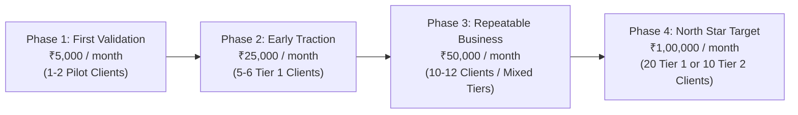

# SOLOEARN Unit Economics & Net Profit Progression Model (M6.2)

To achieve the North Star objective of **₹1,00,000 per month in net owner profit**, every customer engagement must be evaluated using post-tax unit economics rather than gross billing or speculative top-line revenue.

---

## 1. Unit Economics by Service Package

Under the Income-tax Act, 2025 (Section 202 slabs and Section 156 rebate for resident sole proprietors), effective income tax is factored directly into net earnings.

### Tier 1: Business Analytics & Excel Pack (Initial Product)
- **Gross Client Price:** **₹5,000**
- **Payment Gateway / Platform Fee (5%):** -₹250
- **Direct Workspace / Compute Costs:** -₹150
- **Net Pre-Tax Revenue:** **₹4,600** (92.0% gross margin)
- **Estimated Income Tax Reserve (~5.8% to 10% effective):** -₹350
- **Net Owner Profit:** **₹4,250** per completed job
- **Delivery Effort:** ~2.0 hours
- **Effective Hourly Yield:** **₹2,125 / hour**

### Tier 2: CSV Reconciliation Automation
- **Gross Client Price:** **₹10,000**
- **Payment Gateway / Platform Fee (5%):** -₹500
- **Direct Costs:** -₹250
- **Net Pre-Tax Revenue:** **₹9,250**
- **Estimated Income Tax Reserve (~10%):** -₹925
- **Net Owner Profit:** **₹8,325** per completed job
- **Delivery Effort:** ~3.0 hours
- **Effective Hourly Yield:** **₹2,775 / hour**

### Tier 3: Data Engineering ETL Pipeline
- **Gross Client Price:** **₹15,000**
- **Payment Gateway / Platform Fee (5%):** -₹750
- **Direct Costs:** -₹500
- **Net Pre-Tax Revenue:** **₹13,750**
- **Estimated Income Tax Reserve (~12%):** -₹1,650
- **Net Owner Profit:** **₹12,100** per completed job
- **Delivery Effort:** ~5.0 hours
- **Effective Hourly Yield:** **₹2,420 / hour**

### Tier 4: Executive Interactive HTML5 Dashboard
- **Gross Client Price:** **₹20,000**
- **Payment Gateway / Platform Fee (5%):** -₹1,000
- **Direct Costs:** -₹600
- **Net Pre-Tax Revenue:** **₹18,400**
- **Estimated Income Tax Reserve (~15%):** -₹2,760
- **Net Owner Profit:** **₹15,640** per completed job
- **Delivery Effort:** ~6.0 hours
- **Effective Hourly Yield:** **₹2,607 / hour**

---

## 2. Project Profitability Measurement Formula

For every client engagement in SOLOEARN, actual profit is computed as:

$$\text{Net Owner Profit} = R_{\text{received}} - F_{\text{platform}} - C_{\text{direct}} - E_{\text{allocated}} - T_{\text{tax\_reserve}} - \text{Refunds}$$

Where:
- $R_{\text{received}}$: Confirmed bank/UPI credit deposited to business account.
- $F_{\text{platform}}$: Razorpay/Stripe/Upwork gateway processing deductions.
- $C_{\text{direct}}$: Out-of-pocket project costs (e.g., specialized libraries, fonts, verified hosting).
- $E_{\text{allocated}}$: Proportionate share of fixed monthly operating expenses (tools, workstation power).
- $T_{\text{tax\_reserve}}$: Statutory tax withholding set aside under Section 202.
- $\text{Refunds}$: Any client credit notes or chargebacks.

---

## 3. Road to ₹1,00,000 Monthly Net Profit

### Stage Breakdown

| Progression Phase | Target Monthly Net Profit | Projects Needed (Tier 1 @ ₹5k) | Projects Needed (Tier 2 @ ₹10k) | Estimated Owner Delivery Time |
|---|---|---|---|---|
| **Phase 1: First Validation** | **₹5,000** | **1–2 projects** | 1 project | ~4 hours / month |
| **Phase 2: Early Traction** | **₹25,000** | **6 projects** | 3 projects | ~12 hours / month |
| **Phase 3: Repeatable Business** | **₹50,000** | **12 projects** | 6 projects | ~24 hours / month |
| **Phase 4: Primary Objective** | **₹1,00,000** | **24 projects** | 12 projects | ~48 hours / month (~12 hrs/week) |

At ~12 hours of delivery work per week, SOLOEARN achieves ₹1,00,000 monthly take-home profit as a lean, highly efficient solo operation.
