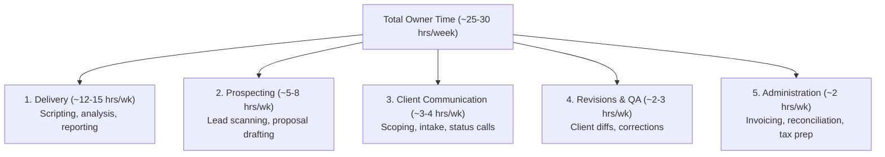
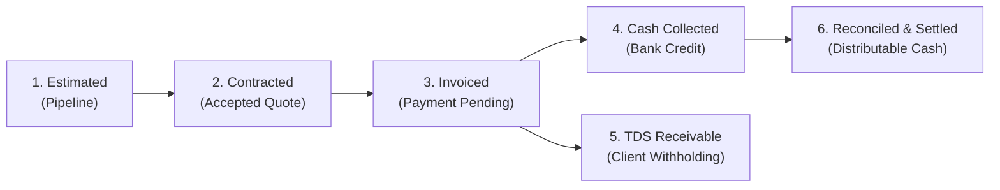

# SOLOEARN Unit Economics & Net Profit Progression Model (M6.2)

To achieve the North Star objective of **₹1,00,000 per month in net owner profit**, every customer engagement must be evaluated using post-tax unit economics and aggregate annual tax modeling rather than speculative top-line revenue or misleading static per-project tax percentages.

---

## 1. Unit Economics by Service Package

Under the Income-tax Act, 2025 (Section 202 slabs and Section 156 rebate for resident sole proprietors), income tax is **not** a flat per-project deduction. It is determined on total aggregate annual income. 

The baseline pre-tax contribution margin is:
$$\text{Pre-Tax Contribution} = \text{Target Price} - \text{Platform Fee (5\%)} - \text{Direct Compute/Storage Cost}$$

### Tier 1: Business Analytics & Excel Pack (Initial Product)
- **Gross Client Price:** **₹5,000**
- **Payment Gateway / Platform Fee (5%):** -₹250
- **Direct Workspace / Compute Costs:** -₹150
- **Pre-Tax Contribution Margin:** **₹4,600** (92.0% gross margin)
- **Estimated Net Post-Tax Yield:**
  - *At 0% effective tax (annual taxable income $\le$ ₹12,00,000):* **₹4,600**
  - *At ~5.75% effective tax (at ₹12.74L scale):* **₹4,336**
  - *At ~8.05% effective tax (at ₹16.31L buffer scale):* **₹4,230**
- **Estimated Delivery Effort:** ~2.0 hours
- **Pre-Tax Hourly Return:** **₹2,300 / hour**

### Tier 2: CSV Reconciliation Automation
- **Gross Client Price:** **₹10,000**
- **Payment Gateway / Platform Fee (5%):** -₹500
- **Direct Costs:** -₹250
- **Pre-Tax Contribution Margin:** **₹9,250** (92.5% gross margin)
- **Estimated Net Post-Tax Yield:**
  - *At 0% effective tax:* **₹9,250**
  - *At ~5.75% effective tax:* **₹8,718**
  - *At ~8.05% effective tax:* **₹8,505**
- **Estimated Delivery Effort:** ~3.0 hours
- **Pre-Tax Hourly Return:** **₹3,083 / hour**

### Tier 3: Data Engineering ETL Pipeline
- **Gross Client Price:** **₹15,000**
- **Payment Gateway / Platform Fee (5%):** -₹750
- **Direct Costs:** -₹500
- **Pre-Tax Contribution Margin:** **₹13,750** (91.7% gross margin)
- **Estimated Net Post-Tax Yield:**
  - *At 0% effective tax:* **₹13,750**
  - *At ~5.75% effective tax:* **₹12,959**
  - *At ~8.05% effective tax:* **₹12,643**
- **Estimated Delivery Effort:** ~5.0 hours
- **Pre-Tax Hourly Return:** **₹2,750 / hour**

### Tier 4: Executive Interactive HTML5 Dashboard
- **Gross Client Price:** **₹20,000**
- **Payment Gateway / Platform Fee (5%):** -₹1,000
- **Direct Costs:** -₹600
- **Pre-Tax Contribution Margin:** **₹18,400** (92.0% gross margin)
- **Estimated Net Post-Tax Yield:**
  - *At 0% effective tax:* **₹18,400**
  - *At ~5.75% effective tax:* **₹17,342**
  - *At ~8.05% effective tax:* **₹16,919**
- **Estimated Delivery Effort:** ~6.0 hours
- **Pre-Tax Hourly Return:** **₹3,067 / hour**

---

## 2. Mathematical Audit of Portfolio Models

### A. The 13-Job Portfolio (Disproven / Shortfall Detected)
Previously, a combination of **6 Analytics + 4 Reconciliation + 3 ETL** was claimed to generate ₹1,00,000 net profit.
An exact audit reveals this is incorrect:
- **Gross Billing:** $6 \times ₹5,000 + 4 \times ₹10,000 + 3 \times ₹15,000 = ₹1,15,000$
- **Pre-Tax Contribution:** $6 \times ₹4,600 + 4 \times ₹9,250 + 3 \times ₹13,750 = ₹1,05,850$
- **Annualized Pre-Tax Profit:** $₹1,05,850 \times 12 = ₹12,70,200$
- **Statutory Annual Tax (FY 2026–27 New Regime):**
  - Section 202 normal slab tax: ₹70,530
  - Section 156 resident rebate & marginal relief: ₹330
  - 4% Health & Education Cess: ₹2,808
  - **Total Annual Tax:** **₹73,008**
  - **Monthly Tax Provision:** **₹6,084**
- **Monthly Post-Tax Net Profit:** $₹1,05,850 - ₹6,084 =$ **₹99,766.00**
- **Result:** **Target missed by ₹234 / month.**
*(Note: If evaluated under arbitrary flat per-tier allocations, the reported yield was only ₹95,100, a ₹4,900 shortfall).*

### B. The 14-Job Portfolio (Minimum Viable Model)
To reliably reach ₹1,00,000 post-tax without unallocated overhead:
- **Mix:** **7 Analytics + 4 Reconciliation + 3 ETL** (14 projects)
- **Gross Billing:** ₹1,20,000
- **Pre-Tax Contribution:** $7 \times ₹4,600 + 4 \times ₹9,250 + 3 \times ₹13,750 = ₹1,10,450$
- **Annualized Pre-Tax Profit:** $₹1,10,450 \times 12 = ₹13,25,400$
- **Statutory Annual Tax:** **₹81,962.40** (Monthly: **₹6,830.20**)
- **Monthly Post-Tax Net Profit:** $₹1,10,450 - ₹6,830.20 =$ **₹1,03,619.80**
- **Cushion:** **+₹3,619.80 / month**

> [!WARNING]
> **Overhead & Acquisition Sensitivity:**
> If fixed unallocated operating expenses (e.g. cloud tools, subscriptions, workstation power) exceed **₹3,620 / month**, or if client acquisition costs (CAC) are incurred, even the 14-job portfolio will fall below the ₹1,00,000 threshold.

---

## 3. The ₹1,25,000 Monthly Safety Buffer Target

To prevent inevitable real-world friction (revisions, delayed payments, platform chargebacks, software subscriptions) from dropping take-home profit below ₹1,00,000, SOLOEARN models an internal **₹1,25,000 / month post-tax safety buffer target** (₹15,00,000 annual net profit):

| Parameter | Statutory Calculation |
|---|---|
| **Target Post-Tax Profit** | **₹1,25,000 / month** (₹15,00,000 / year) |
| **Required Pre-Tax Business Profit** | **₹16,31,313.12 / year** (**₹1,35,942.76 / month**) |
| **Statutory Income Tax Liability** | **₹1,31,313.12 / year** (**₹10,942.76 / month**) |
| **Effective Tax Rate** | **8.05%** |
| **Required Tier 1 Jobs (@ ₹4,600 pre-tax)** | **30 jobs / month** |
| **Balanced Portfolio Needed** | **9 Analytics + 5 Reconciliation + 4 ETL** (18 jobs) |

---

## 4. Owner Time Tracking & Total Operational Labor

Delivery time is only one component of a solo business. SOLOEARN tracks owner labor across **5 operational categories**:

1. **Delivery:** Time spent executing pipelines, producing Excel workbooks, and creating HTML dashboards.
2. **Prospecting:** Reviewing opportunity boards, customizing proposals, and validating requirements.
3. **Client Communication:** Initial qualification, intake clarifications, and progress updates.
4. **Revisions:** Addressing customer feedback, modifying deliverables, and running regression checks.
5. **Administration:** Reconciling bank statements, tracking expenses, filing taxes, and managing system infrastructure.

---

## 5. Distinct Financial States

To prevent misleading revenue projections, SOLOEARN strictly separates financial lifecycle states:

1. **Estimated Pipeline:** Unconfirmed opportunities and initial quotes.
2. **Contracted Pipeline:** Work authorized by client, awaiting delivery and invoicing.
3. **Invoiced (Receivables):** Deliverables completed and invoice sent; pending payment.
4. **Cash Collected:** Actual bank credits received; gross cash.
5. **TDS Receivable:** Tax deducted at source by corporate clients (e.g. 10% under Section 194J) that offsets annual income tax liability.
6. **Reconciled & Distributable:** Transactions confirmed against bank statements, minus GST collected and statutory tax reserves.
